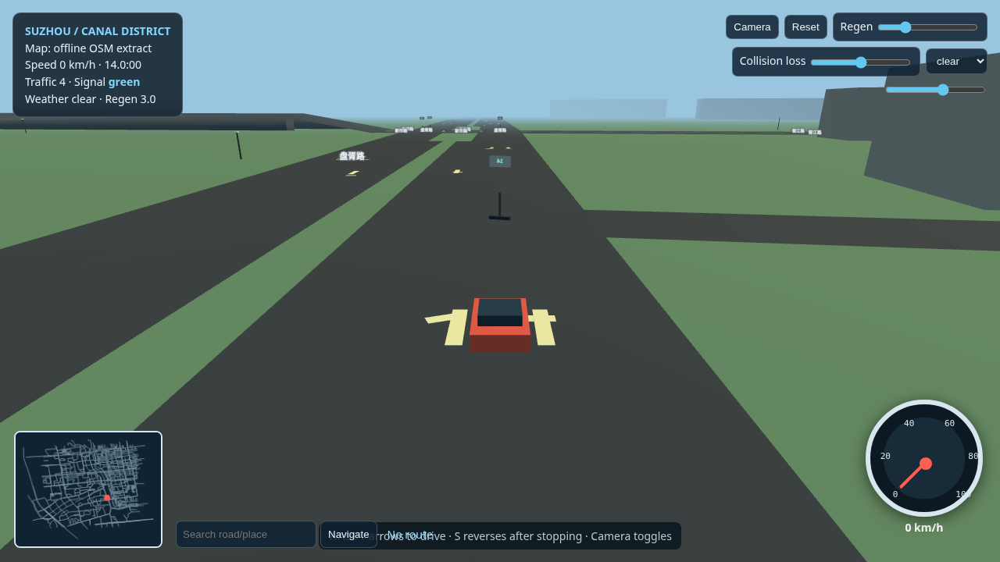
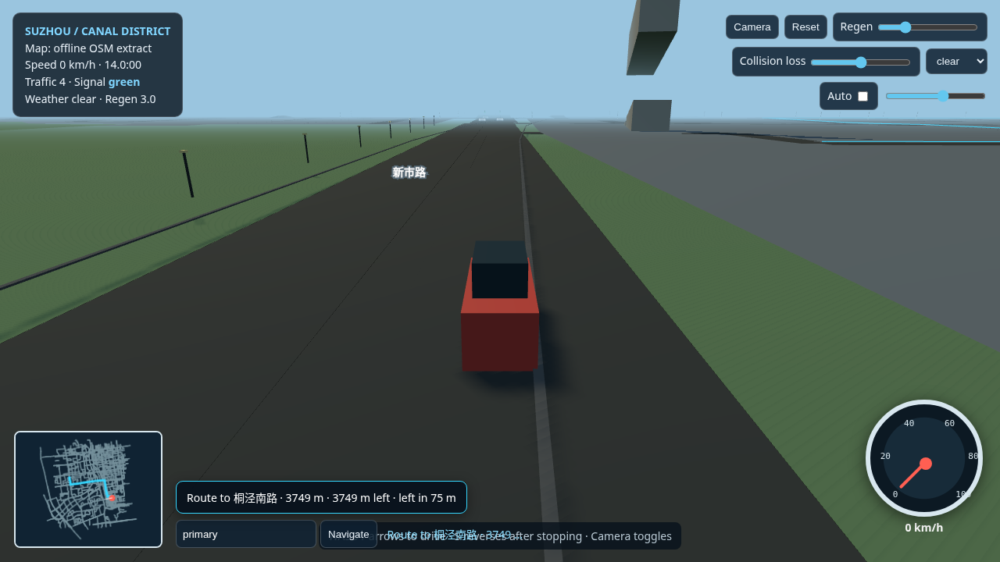
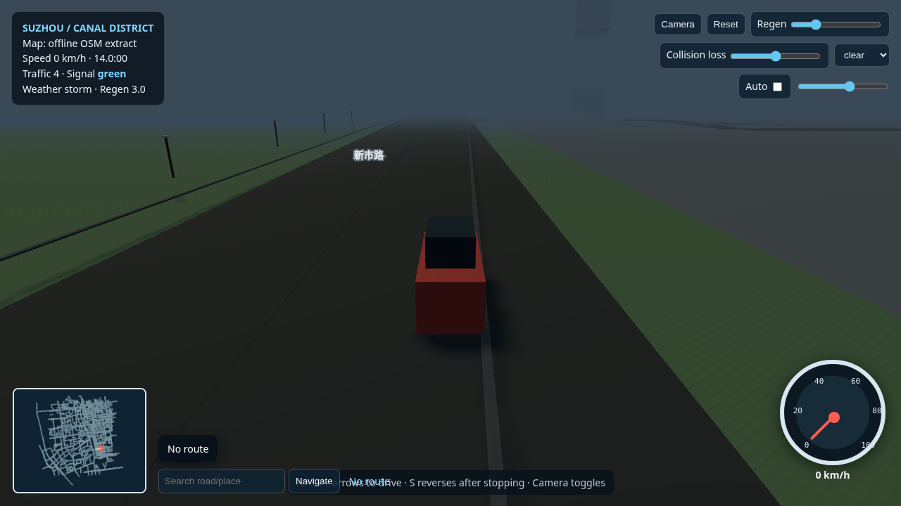

<p align="center">
  <a href="README.md">English</a> | <strong>简体中文</strong>
</p>

<p align="center">
  
</p>

<h1 align="center">Suzhou Drive</h1>
<h3 align="center">建立在真实苏州街道地图上的离线驾驶模拟器。</h3>

<p align="center"><strong>在浏览器里开车穿过苏州中心城区：车道级路线、会变化的信号灯、天气、碰撞和运河危险，全部来自仓库内的一份 OpenStreetMap 数据。不需要地图 API key，不需要瓦片服务器，运行时也不联网。</strong></p>

<p align="center">
  
</p>

<p align="center"><sub>0.1.0 验证截图：OSM 道路、车道箭头、车流、小地图和速度表。</sub></p>

## 快速上手

需要 Node.js `^20.19.0` 或 `>=22.12.0`（Vite 7）以及 npm。在仓库根目录执行：

```bash
npm ci
npm run dev
```

打开 <http://localhost:5173> 即可驾驶。地图从 `public/suzhou.osm` 读取，运行时不请求任何外部服务。

| 操作 | 作用 |
| --- | --- |
| `W` `A` `S` `D` 或方向键 | 加速、转向、刹车；停车后按 `S` 倒车 |
| Camera | 切换跟随视角 / 驾驶舱视角 |
| Reset | 回到出生点 |
| Regen、Collision loss | 调整滑行制动和碰撞时的速度损失 |
| Weather、Auto、时间滑块 | 选择天气、开启自动天气、调整时刻 |
| 搜索道路或地点 + Navigate | 规划到具名 OSM 道路或地点的路线 |

## 现在能做什么

- **真实街道，不依赖服务。** 渲染苏州中心城区 11.5 MB 的 OSM 数据（北纬 31.28–31.32，东经 120.58–120.62），包含 7,322 条道路和 48,308 个节点，以及建筑、水域、桥梁和具名地点。
- **车道级导航。** 路线沿 OSM 道路图计算，遵守 `oneway`、`lanes`、`turn:lanes` 和 `change:lanes`。路面标线、车道箭头、路线、小地图和剩余距离提示都来自同一份数据；逆行会自动重新规划。
- **会工作的路口。** 符合条件的三个及以上方向路口会生成带倒计时的信号灯，车流会响应灯色；限速标志由 OSM 标签渲染。
- **天气与昼夜。** 晴、多云、雨、雾、暴风雨五种天气，可手动切换或自动变化，并有 24 小时的太阳、雾和雨效循环。
- **有后果的物理。** 车辆碰撞、可调的能量回收和碰撞损失、运河溺水、高架桥和坠落。
- **车流与路侧装饰。** 程序化生成的车辆、树木、路灯和建筑会避开道路与水面。车辆目录还定义了摩托车、自行车、三轮车、卡车、公交车、直升机和喷气机；飞行器只在目录中，不会生成在道路上。

<details>
<summary><strong>更多截图</strong></summary>
<br />
<table>
  <tr>
    <td width="50%"></td>
    <td width="50%"></td>
  </tr>
  <tr>
    <td><sub>车道路线、剩余距离和小地图。</sub></td>
    <td><sub>暴风雨状态：雾、光照和降雨。</sub></td>
  </tr>
</table>
</details>

## 架构

| 模块 | 职责 |
| --- | --- |
| `src/osm.ts` | 把 OSM XML 解析成道路、建筑、水域、区域、铁路和具名地点。 |
| `src/sim.ts` | 车辆状态、碰撞、信号灯、车流跟随和右侧通行规则。 |
| `src/navigation.ts` | 车道路线、标线、转向提示、逆行检测和重新规划。 |
| `src/weather.ts` | 天气状态、自动转换和光照参数。 |
| `src/vehicles.ts` | 车辆目录、尺寸和动力学。 |
| `src/main.ts` | 唯一负责 Three.js 集成的地方：场景、HUD、小地图、控件和调试接口。 |
| `src/style.css` | HUD 和控件布局。 |

`public/suzhou.osm` → `osm.ts` → `main.ts` → Three.js 场景和 HUD。导航、模拟、天气和车辆行为保持与渲染器无关，因此不启动浏览器也能做单元测试。E2E 测试运行真实应用，并通过 `src/main.ts` 暴露的 `window.__driveDebug` 接口读取状态。

## 开发

```bash
npm test                                  # 40 个单元测试
npm run build                             # tsc && vite build
npx playwright install chromium           # 首次运行浏览器测试前执行一次
npm run test:e2e -- --workers=1           # 26 个测试：25 通过，1 跳过
```

0.1.0 记录的验证结果是：40 个单元测试通过，构建通过（Vite 仍有既有的 >500 kB 分块警告），E2E 25/26 通过。唯一跳过的是具名地点导航，因为仓库内的 OSM 数据没有可匹配的地点。结果和检查过的截图记录在 [`.scratch/roadmap-v2/final-verification.md`](.scratch/roadmap-v2/final-verification.md)。

## 参与贡献

请先读 [`CONTRIBUTING.md`](CONTRIBUTING.md)，再读 [`AGENTS.md`](AGENTS.md) 和 [`docs/agents/`](docs/agents/) 下的说明。提交 issue 时请附上复现步骤和证据；PR 应聚焦单一改动，规则变化要补测试，并跑完上面的检查。评审和合并由人类负责。生成出来的 `dist/`、`test-results/` 和 `node_modules/` 不是源码。

## 路线图

**状态：里程碑已关闭。** 0.1.0 于 2026-08-25 发布，里程碑于 2026-09-29 关闭；文档中的 `roadmap-v2` 切片已经交付，除非输入或目标变化，否则没有后续开发计划。版本号以 `package.json` 为准，发布说明记录在 [`CHANGELOG.md`](CHANGELOG.md)。

### 已实现

- 离线 OSM 世界：道路、高程、桥梁、水域、建筑和具名地点。
- 车道级路线、标线、车道箭头、逆行检测和自动重新规划。
- 信号灯倒计时、限速标志，以及遵守路线和灯色的车流。
- 五种天气及自动切换，外加 24 小时光照循环。
- 碰撞、能量回收和碰撞损失调节、运河溺水和高架坠落。
- 程序化生成的交通与路侧装饰；车辆目录和不同动力学。
- 0.1.0 验证门禁，以及 `docs/media/` 中保留的截图。

### 计划与暂缓

没有日期，也没有承诺的范围。已记录的后续事项大致按价值排序：

- 增加具名地点测试夹具，让被跳过的导航 E2E 用例可以运行。
- 在目标硬件上测量启动时间、持续帧率和内存。
- 通过拆分或裁剪依赖解决 >500 kB 的分块警告。
- 扩大地图覆盖范围，调整 HUD 布局。

多人模式、外部地图服务和投机性的渲染依赖不在 0.1.0 范围内。

### 未来设想

如果这个切片值得继续投入，Suzhou Drive 可以成为一个可复用的离线 OSM 驾驶沙盒：换入另一座城市的数据，沿用同一套导航、车流、天气和危险系统，并对结果做测量。边界保持不变——数据放在仓库里，不接外部地图服务，每一项新能力都有测试或可见检查作为依据。

## 数据与许可

软件使用 [AGPL-3.0-only](LICENSE)。

地图数据 © [OpenStreetMap contributors](https://www.openstreetmap.org/copyright)，以 [Open Database License (ODbL)](https://opendatacommons.org/licenses/odbl/) 提供。`public/suzhou.osm` 属于第三方数据，其署名和 ODbL 条款独立于软件许可。
